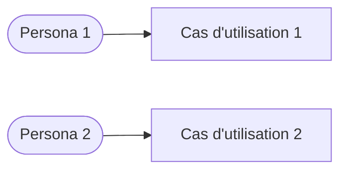

# [Nom du projet] — Cas d'utilisation

## Diagramme global

## [N]. [Nom du cas d'utilisation]

- **Nom** :
- **Acteur** :
- **Acteur secondaire** : Aucun
- **Déclencheur** : [ce qui lance le cas]

**Flot principal**
1. Le système …
2. L'utilisateur …
3. …
4. Fin

**Flots alternatifs**
- 2a) [Situation]
  - 2a1) …
  - 2a2) Retour à l'étape 1 / Passage à l'étape N / Fin
