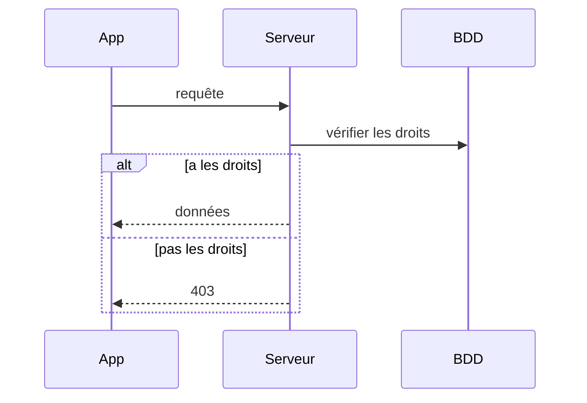

# Itération [NN] — [Nom de la story]

| MoSCoW | Story | Difficulté |
|---|---|---|
| | En tant que … je souhaite … afin de … | |

## 1. Analyse et conception

### Identification des tâches

- **[Tâche 1]** : [description du point de vue de l'utilisateur : écran, bouton, redirection]
- **[Tâche 2]** :

### Échanges interface / serveur / base

## 2. Implémentation

### Front-end

- Bibliothèques ajoutées : [nom : pourquoi]
- [Ce qui a été fait, captures d'écran]

### Back-end

- [Ce qui a été fait]
- Documentation mise à jour : [ ] `04-donnees.md` [ ] `05-api.md`

## 3. Test

- [Tests automatiques ajoutés]
- [Tests manuels, sur quel appareil]
- Flots alternatifs testés : [liste]

## 4. Évaluation

[Démonstration : ce que voit l'utilisateur, étape par étape. La story correspond-elle aux attentes ?]

## Problèmes rencontrés

- **[Problème]** : ce qui s'est passé, pourquoi, solution retenue.
